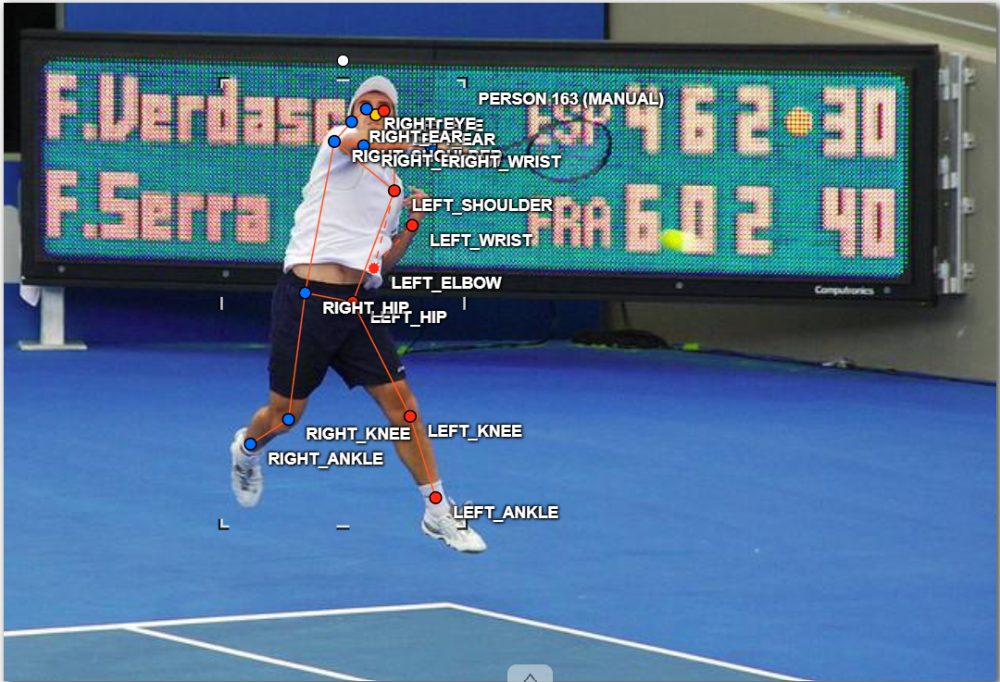
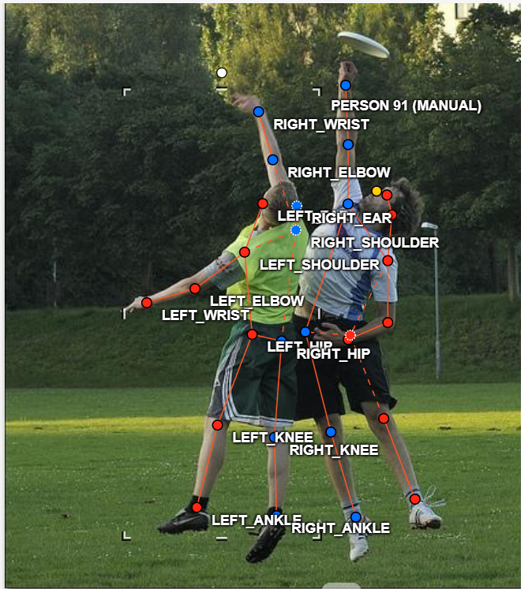
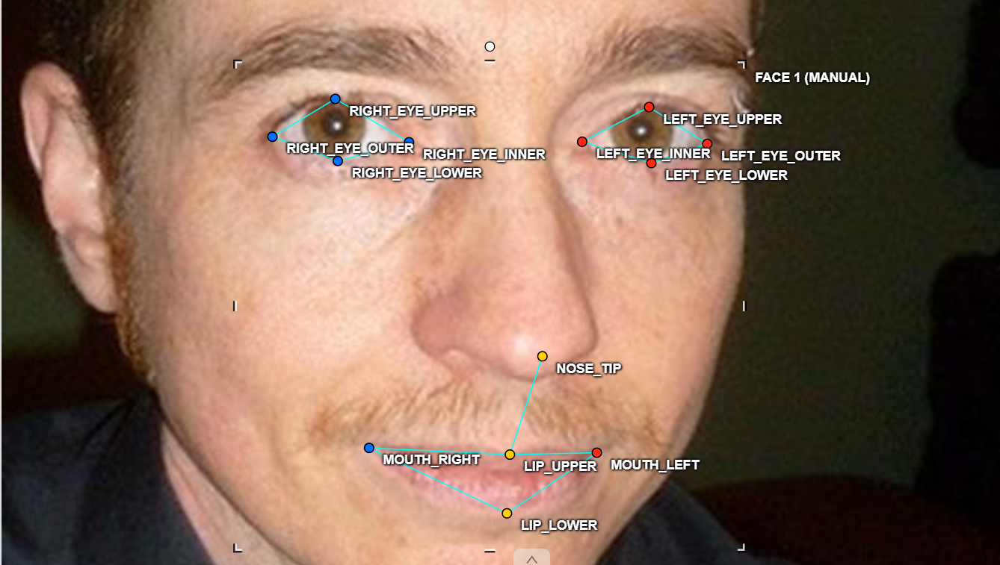
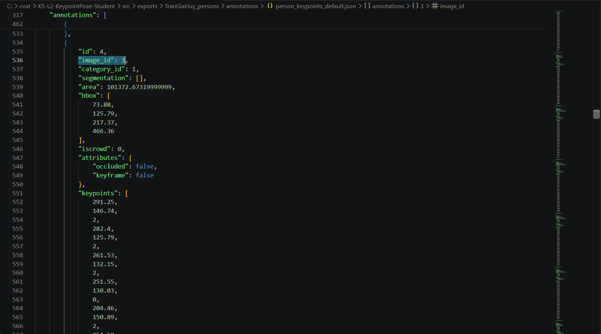

# Báo cáo cá nhân — HoVaTen-MSSV

Đổi tên file theo quy tắc `MSSV_HoTen.md`. Ví dụ: `20241234_NguyenVanAn.md`.

Dữ liệu: 12 ảnh người COCO val2017 (Lin et al., 2014) và 8 ảnh chân dung Wikimedia Commons, chỉ dùng trong lớp.

## 0. Thông tin học viên

- Họ tên: Trần Gia Huy
- MSSV: 2A202603049
- Email: trngiahuyyy@gmail.com
- Link repository: https://github.com/trngiahuyyyy/K5-L2-DAY04-TranGiaHuy-2A202603049-KeypointPose
- Phiên bản CVAT (Help → About): 2.82.1
- Máy: hệ điều hành Window · RAM 16 GB · chạy CVAT chế độ đầy đủ
- Bộ ảnh (`src/exports/assignment.json` do `lab.py setup` tạo): có
- Giờ bắt đầu: 16h30
- Giờ kết thúc: 19h30

## 1. Kiểm tra label (CP0)

| Label | Kiểu | Số điểm | Tên điểm đúng bảng của lab? | Đúng thứ tự? | Số cạnh |
|---|---|---:|---|---|---:|
| `person` | Skeleton | 17 | Có | Có | 19 |
| `face` | Skeleton | 13 | Có | Có | 13 |

Mẫu `person` dựng theo người quay mặt về camera (các điểm `left_*` nằm bên phải khung mẫu)? Có

Cách đổi cờ `occluded` / `outside` cho **một điểm** trên phiên bản CVAT này (một câu): Click chọn 1 điểm và bấm phím Q (Occluded), phím O (Outside)

## 2. Số lượng đã gán và thời gian (CP1, CP2)

| Nhóm ảnh | Số ảnh | Số skeleton đã gán | Số người dưới 60 px (không gán) | Số poster / gương / màn hình bỏ qua | Thời gian (phút) |
|---|---:|---:|---:|---:|---:|
| `easy` | 5 | 5 | 1 | 0 | 25 |
| `occluded` | 3 | 7 | 2 | 0 | 21  |
| `back` | 3 | 6 | 0 | 0 | 8 |
| `small` | 0 | — | — | — | — |
| `crowd` | 1 | 1 | 6 | 0 | 5 |
| `faces` | 8 | 8 | — | 0 | 24 |

- Số ảnh người đã xong ở mốc phút 105: 8 / 10
- Thời gian thực tế (phút): CP1 90 · CP2 25 · CP3 20
- Ảnh tốn thời gian nhất là ảnh nào, vì sao?
   Ảnh 000000324953.jpg vì trong ảnh có 1 người đầu bếp đứng gần như hướng mặt sang bên trái, khó để xác định trái phải và vị trí hip.

## 3. Bảng ca khó (CP1, CP2)

Mỗi điểm bạn phân vân một dòng, nhất là phân vân giữa `v = 1` và `v = 0`, hoặc không chắc hướng người.

| Ảnh | Người / mặt | Điểm | Cờ đã chọn | Phân vân giữa | Lý do chọn |
|---|---|---|---:|---|---|
| 000000189365.jpg | Người | nose, right ear | v=0 | v=1 | do sát khung ảnh quá nên set outside |
| 000000147780.jpg | Người | left hip, right knee | v=1 | v=0 | Bị ngựa che khuất nhưng vẫn đoán được |
| 000000210604.jpg | Người | nose, right eye, left eye, right ear, left ear | v=0 | v=1 | Do mặt hướng góc 45-60 độ lên trời, không đoán được điểm |

## 4. Bảng tự review (CP3)

Đi từ ảnh cuối về ảnh đầu. 5 ảnh người (ít nhất 2 ảnh `back` hoặc `crowd`) và 3 ảnh mặt. Ít nhất 8 dòng, kể cả dòng `ok`. Ghi lỗi trước, sửa sau.

Mã lỗi dùng đúng một trong: `lr_swap`, `vis_flag`, `position`, `missing`, `extra`, `ok`.

| Ảnh | Người / mặt | Điểm | Mã lỗi | Ghi chú | Đã sửa? |
|---|---|---|---|---|---|
| 000000324953.jpg | Người | left hip, right hip | lr_swap | bị nhầm phía | ok |
| 000000189365.jpg | Người | Skeleton | missing  | còn người áo đỏ quên không gán | ok |
| face_342273.jpg | mặt | Skeleton | extra | lúc đầu định gán thêm cho người ngoài rìa nhưng sau khi bị báo lỗi nên đã sửa | ok |
| | | | | | |
| | | | | | |
| | | | | | |
| | | | | | |
| | | | | | |

Tổng hợp số lỗi theo mã:

| `lr_swap` | `vis_flag` | `position` | `missing` | `extra` | `ok` |
|---:|---:|---:|---:|---:|---:|
| | | | | | |

Điểm còn phân vân giữa `v = 1` và `v = 0` (ghi cả hai lựa chọn và lý do chọn):

...

## 5. Kiểm file xuất và kết quả tự kiểm (CP4)

Tự kiểm tay trong file JSON:

| File | Người / mặt kiểm (ảnh, thứ tự) | Số phần tử `keypoints` | Điểm `outside` ra `v = 0`, `occluded` ra `v = 1`? | `num_keypoints` khớp? |
|---|---|---:|---|---|
| `TranGiaHuy_persons.zip` | `000000162046.jpg`, người #1 | 51 | Có. 5 điểm `occluded` (left_ear, left_shoulder, left_elbow, left_wrist, left_ankle) ra `v = 1`; không có điểm `outside` | Có: 17 điểm `v > 0`, `num_keypoints` = 17 |
| `TranGiaHuy_persons.zip` | `000000189365.jpg`, người #1 (người chơi tennis) | 51 | Có. 4 điểm `outside` (left_ear, right_hip, left_ankle, right_ankle) ra `v = 0`; không có điểm `occluded` | Có: 13 điểm `v > 0`, `num_keypoints` = 13 |
| `TranGiaHuy_faces.zip` | `face_256814.jpg`, mặt #1 (kính râm) | 39 | Có. 8 điểm mắt `occluded` ra `v = 1`; không có điểm `outside` | Có: 13 điểm `v > 0`, `num_keypoints` = 13 |

Sau khi xuất, CVAT ghi `occluded` thành `v = 1` và `outside` thành `v = 0`. Tọa độ của điểm `outside` trong file là **tọa độ cũ**, không phải `0, 0`. Ví dụ `right_ankle` của người tennis có `v = 0` nhưng vẫn mang tọa độ (4.56, 715.13), và ảnh chỉ cao 640.

Hai job đã chuyển sang completed trên CVAT? Có

Dán phần **TÓM TẮT** in ra từ `src/check_submission.py`:

```text
- File person: TranGiaHuy_persons.zip
  Số ảnh: 12 · số skeleton `person`: 19 · mỗi annotation 51 số
  Skeleton theo ảnh: 000000147780=2, 000000162046=1, 000000189365=2, 000000196283=1, 000000210604=2, 000000241837=1, 000000253584=1, 000000261732=1, 000000324953=2, 000000326480=3, 000000429594=1, 000000431988=2
  Cờ v: v=2 227 (70%) · v=1 48 (15%) · v=0 48 (15%)
  num_keypoints trung bình: 14.5
- File face: TranGiaHuy_faces.zip
  Số ảnh: 8 · số skeleton `face`: 8 · mỗi annotation 39 số
  Skeleton theo ảnh: face_122747=1, face_232598=1, face_256814=1, face_342273=1, face_380639=1, face_505385=1, face_562485=1, face_79591=1
  Cờ v: v=2 95 (91%) · v=1 9 (9%) · v=0 0 (0%)
  num_keypoints trung bình: 13.0
- Ghi chú: 48 điểm v = 0 vẫn mang tọa độ cũ (CVAT 2.x xuất như vậy; chuẩn COCO ghi 0, 0). Không phải lỗi: điểm v = 0 bị bỏ qua khi huấn luyện và khi chấm.
- Số [LỖI]: 0 · số [CẢNH BÁO]: 0
Kết quả: ĐẠT   
```

Các `[CẢNH BÁO]` còn giữ nguyên và lý do:
   0 có cảnh báo
...

## 6. Ảnh chụp màn hình

1. Label `person` trong label constructor (đủ 17 điểm có tên):

   

2. Một người quay lưng đã gán, cờ đã đặt:

   

3. Một khuôn mặt đã gán 13 điểm, phóng to vùng mắt:

   

4. Một đoạn JSON xuất của một người:

   

Nguồn ảnh: COCO val2017 / Wikimedia Commons.

## 7. Tự đánh giá

1. Lỗi bạn mắc nhiều nhất hôm nay, và cách bạn sẽ tránh ở dự án thật:

   Lỗi với người bị quay lưng và outside, sẽ tránh bằng cách sẽ kéo đúng phía trước r mới gán vào đúng điểm ảnh.

2. Một quy tắc bạn đề xuất thêm vào guideline (kèm ảnh ví dụ nếu có):

   ...

3. Nhãn của bạn đi vào model ở đâu? Chọn một lỗi bạn đã sửa và nói nó sẽ làm model học sai thế nào (heatmap, trọng số trong loss, hay bước lật ảnh):
   Lỗi tôi chọn: `right_hip` ở `000000189365` mang `v = 2` dù khớp nằm ngoài ảnh. Script báo `[LỖI]`.
Nếu không sửa, nhãn này đi vào model ở <heatmap / trọng số trong loss>, vì sẽ gây nhiễu tâm phân bố Model sẽ học sai quy luật giải phẫu hình thể
   ...

## 8. Khó khăn và lỗi kỹ thuật

- Lỗi kỹ thuật của CVAT không gặp lỗi làm mất dữ liệu hay không xuất được file. `python lab.py export` chạy được cả hai task.
- Script tự kiểm báo lỗi ở lần export đầu `right_hip` của người chơi tennis ở `000000189365.jpg` mang `v = 2` dù nằm ngoài ảnh. Tôi đổi điểm đó sang `outside`. Script cũng cảnh báo `face_342273.jpg` có 2 skeleton, tôi xóa skeleton thừa. Export lại thì `Kết quả: ĐẠT`.
- Đo chiều cao người nhỏ CVAT không có thước đo pixel, nên khó biết người ở nền có đủ 60 px không. Tôi chụp màn hình rồi dùng thước pixel của Paint.NET. Người áo xanh lá ở `000000253584.jpg` đo được khoảng 52 px, nên không gán.
- Tên điểm chồng lên nhau ở người nhỏ, chữ `RIGHT_EYE`, `RIGHT_EAR`, `NOSE` đè lên nhau và che mất điểm. Tôi phóng to khi đặt điểm vùng đầu, bật tên điểm lại khi review trái/phải.
- Lỗi chỉ thấy khi phóng to ở `000000189365.jpg`, mũi và tai phải của người áo đỏ bị đặt sát mép trên ảnh trong khi khớp thật nằm ngoài ảnh. Script không báo vì điểm vẫn nằm trong ảnh, tôi tự phát hiện khi phóng to rồi đổi sang `outside`.

## Bonus (nếu làm)

### B1 — 3 ảnh người khó thêm

| Ảnh | Số skeleton | Số người dưới 60 px | Ca khó nhất |
|---|---:|---:|---|
| | | | |
| | | | |
| | | | |

Kết quả `src/check_submission.py` cho `HoVaTen_bonus_persons.zip`:

```text
(dán ở đây)
```

### B2 — 5 ảnh khuôn mặt đen trắng / hồng ngoại

Ảnh không màu khó hơn ở điểm nào? Kính râm trên ảnh hồng ngoại có còn là `v = 1` không?

...

### B3 — Model so với nhãn của tôi (không tính điểm)

- Demo đã dùng:
- Ảnh đã thử:

1. Model có trả điểm cho khớp bị che, hay khớp ngoài ảnh không? Confidence ở các điểm đó thế nào?

   ...

2. Với người quay lưng, model có đổi trái/phải không?

   ...

3. Bộ điểm của model có giống 17 điểm COCO không?

   ...

## 9. Tài liệu tham khảo và công cụ AI đã dùng

   Sử dụng claude.ai để hỗ trợ kiểm tra và các tài liệu do BTC cấp
